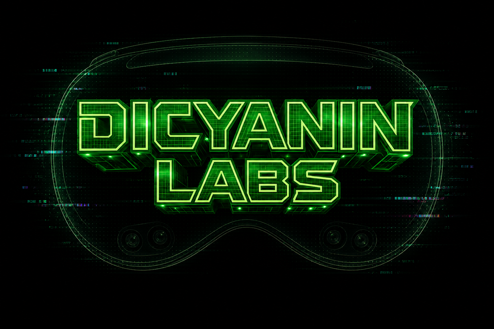

# DicyaninPackagesV2

Recent visionOS Swift packages from Dicyanin Labs. Older packages remain listed in [DicyaninPackages](https://github.com/hunterh37/DicyaninPackages).

## Packages

| Package | Description |
|---------|-------------|
| [DicyaninArmsInput](https://github.com/hunterh37/DicyaninArmsInput) | Webcam hand tracking to DicyaninSimulatorArms with pinch and poke events |
| [DicyaninParametricFit](https://github.com/hunterh37/DicyaninParametricFit) | Fits parametric primitives to scene mesh clusters and outputs a Codable ShapeGraph |
| [DicyaninPerfProbe](https://github.com/hunterh37/DicyaninPerfProbe) | Headless frame-rate and hitch capture with baseline diffs for visionOS apps |
| [DicyaninRealityMirror](https://github.com/hunterh37/DicyaninRealityMirror) | Records visionOS demo footage from an iPhone by mirroring the headset RealityKit scene |
| [DicyaninRoomWorlds](https://github.com/hunterh37/DicyaninRoomWorlds) | Scan a room, generate a themed 3D world fitted to it on device |
| [DicyaninSplash](https://github.com/hunterh37/DicyaninSplash) | Two-phase visionOS / iOS launch splash with glitch title, loading bar and holographic 3D title |
| [DicyaninStageDirector](https://github.com/hunterh37/DicyaninStageDirector) | Route-based control surface for recording visionOS demo takes from a headless simulator |
| [RealityHD](https://github.com/hunterh37/RealityHD) | High-detail RealityKit scenes, nature and props |

## Screenshots

### DicyaninRoomWorlds

| Scan | Forest | Desert |
|------|--------|--------|
|  |  |  |

### RealityHD

---

  

